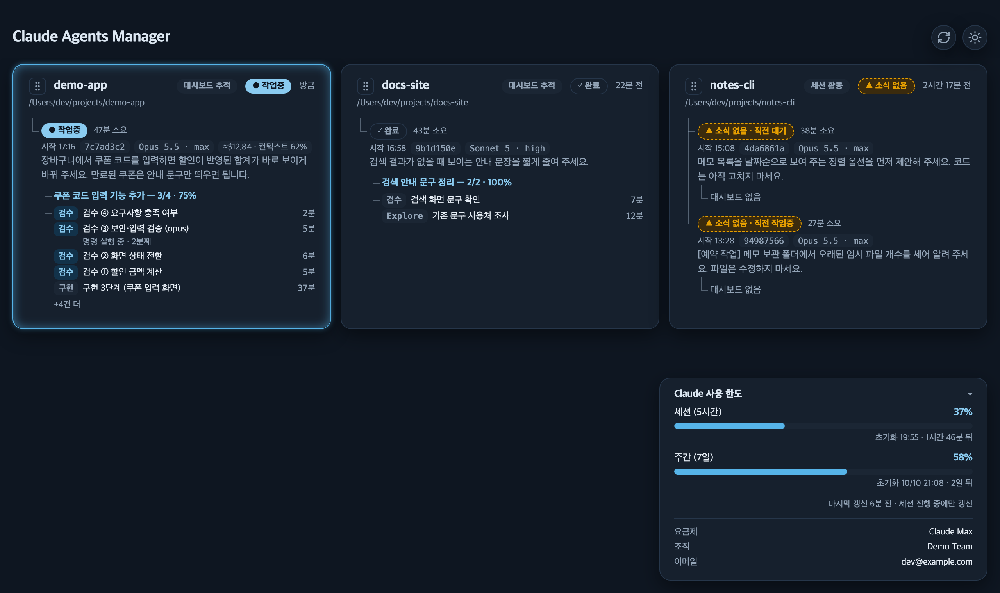
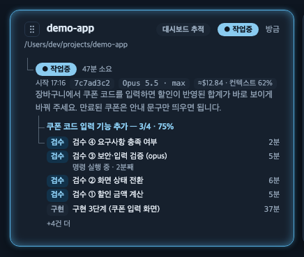
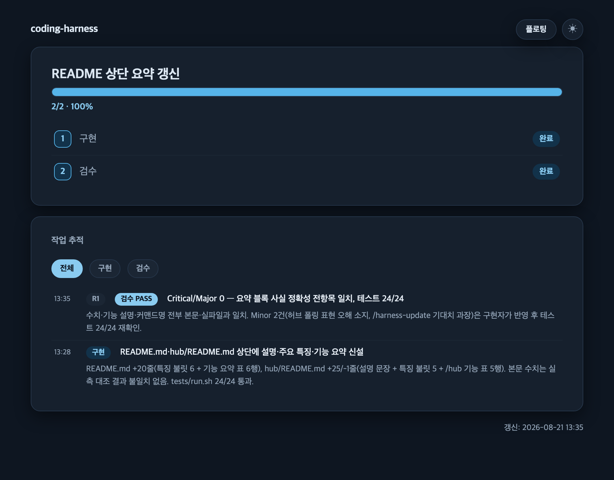

# 통합 허브 대시보드

여러 프로젝트를 넘나들며 개발할 때, 지금 어느 프로젝트가 무엇을 하고 있는지 일일이 창을
열어보지 않고 한 화면에서 확인하려고 만든 도구다. 로컬 머신에서 돌고 있는 **모든 Claude
Code 프로젝트**의 진행 상황(프로젝트/세션/단계)을
한 페이지에서 **읽기 전용**으로 본다. 명령·제어 기능(중단·프롬프트 주입·승인)은 범위 밖이다.

**주요 특징**

- 프로젝트마다 "가진 것 중 가장 높은 티어"로 보여주는 3단계 강등 구조(대시보드 추적 →
  세션 활동 → 세션 없음) — 뭐라도 있으면 목록에 나타난다
- 프라이버시 우선 설계 — 프롬프트 발췌 상한·보관 기간·수집 항목을 옵트인/옵트아웃으로
  직접 제어한다
- 카드를 드래그해 순서를 직접 정하고, 카드·세션 행을 눌러 세션별 상세와 대시보드를 바로 본다
- 세션(5시간)·주간(7일) 사용량 한도를 패널 하나로 보여준다(옵트인). 펼치면 어느 계정의 한도인지도 보인다
- 세션 줄 아래에 서브에이전트 실행이 1건당 한 줄로 나열되고, 도는 실행에는 활동 한 줄이 붙는다(도구 종류와 경과
  시간만 — 명령·출력 내용은 싣지 않는다). 턴은 끝났지만 백그라운드 작업이 남아 기다리는 세션은 「백그라운드
  대기」로 따로 표시된다
- 상태줄을 켠 세션에는 추정 비용과 컨텍스트 사용률 칩이 붙는다(옵트인, 정가 기준 추정)

**`/hub` 로 할 수 있는 일**

| 영역 | 기능 |
|------|------|
| 열기 | 서버가 살아 있으면 그 화면을, 꺼져 있으면 1회 수집 결과를 연다 |
| 서버 | 상주 프로세스 시작·정지·재기동·상태 확인 |
| 훅 | 세션 이벤트를 모으는 전역 훅 7종 옵트인 설치·제거 |
| 상태줄 | 터미널에 사용량 한 줄 표시 옵트인 |
| 진행 기록 | 이 프로젝트의 진행 기록(대시보드) 켜기·끄기 — `/hub dashboard on\|off` |
| 진단 | 훅·이벤트·서버·사용량 상태를 한 번에 점검 |



- **프로젝트 카드** — `demo-app`(대시보드 추적 · 작업중), `docs-site`(대시보드 추적 · 완료),
  `notes-cli`(세션 활동 · 소식 없음) 세 장이 놓인다
- **사용량 패널** — 우하단에 고정되고, 펼치면 세션·주간 막대와 초기화 시각, 요금제·조직·이메일 줄이 보인다

**카드 한 장에 보이는 멀티 에이전트 작업** — coding-harness 워크플로우(설계 → 승인 → 구현 → 검수)로
일하는 세션은 허브에서 이렇게 보인다.



- **세션 줄** — 첫 줄은 상태(설계를 마치고 승인을 기다리는 세션이면 바로 뒤에 경고색 테두리의 `◆ 승인 대기` 표지)와
  「N분 소요」, 둘째 줄은 시작 시각·ID·모델과 effort(`Opus 5.5 · max`)·
  추정 비용과 컨텍스트 사용률 칩(`≈$12.84 · 컨텍스트 62%`), 그 아래가 마지막 프롬프트 발췌다
- **진행률 줄** — 「쿠폰 코드 입력 기능 추가 — 3/4 · 75%」처럼, 그 세션이 진행 기록기
  (`hub_dashboard_log.py`, 아래 「진행 기록」)로 기록한 작업 제목과 단계 진행이 글자로만 나온다.
  지금 어느 단계인지는 세션 줄·카드를 눌러 상세 패널에 여는 그 세션의 대시보드에서 본다(서버 모드에서만
  눌리고, 끝난 작업의 대시보드는 열리지 않는다). 다만 「내 승인을 기다리는 중」만은 카드를 열지 않아도 첫 줄의
  `◆ 승인 대기` 표지로 보인다
- **병렬 검수** — 관점을 나눈 `code-reviewer` 4건(검수 ①~④)이 동시에 돈다(강조색 칩 = 실행 중).
  모델을 올리는 대신 검수자를 나눠 병렬로 돌리고, 민감한 관점 1건(③)만 opus 로
  올렸다(제목의 `(opus)`) — [`../rules/workflow/model-routing.md`](../rules/workflow/model-routing.md)
  의 검수 원칙이 화면에 그대로 드러난다
- **활동 줄** — 도는 실행 하나에는 `명령 실행 중 · 2분째` 같은 활동 줄이 붙는다
- **앞 단계 실행** — 끝난 구현 실행은 중립색으로 남고, 5줄을 넘는 실행은 `+4건 더` 로 접힌다

**coding-harness 설치와 완전히 별개다.** `install.sh --scope project|user` 를 실행해도 허브는
설치되지 않는다 — 허브는 상주 프로세스와 전역 훅을 남기는 별도 자산이라, 설치 동의도
분리돼 있다. 허브 사용자가 coding-harness 의 `install.sh` 를 손으로(즉 `/harness-update` 를 거치지
않고) 다시 돌렸다면 `hub/install.sh` 도 함께 돌려야 한다 — `/harness-update` 는 이 둘의 갱신
여부를 각각 비교해 함께 처리하지만, `install.sh` 단독 재실행은 허브 자산을 건드리지 않는다.

---

## 요구사항

- `python3` **3.10 이상** — `hub/install.sh` 가 설치 때 버전을 확인한다.
- macOS Keychain — 사용량 API 폴링(`usage_api_enabled`, 옵트인·macOS 전용)을 켤 때만
  필요하다. 아래 「설정」 절 참조.

## 설치

```bash
hub/install.sh
```

`~/.claude/hub/bin/` 에 37개 파일을, `~/.claude/rules/hub/` 에 규칙 1개(허브 사용자만 받는
진행 기록 지침, [`rules/dashboard-recording.md`](rules/dashboard-recording.md))를 설치한다.
`--scope` 인자가 없다 — 설치 위치는 이 둘뿐이며, 머신 전역 자산이라 프로젝트마다 사본을
두지 않는다.

- `--force` — 수정된 파일이 있어도 덮어쓴다
- `--dry-run` — 계획만 출력(파일시스템 변경 없음)
- `--uninstall` — 서버 정지 → 훅 제거 → statusLine 제거 → 규칙 파일 제거 → `bin/` 삭제(순서
  고정, 아래 「제거」 참조)

## 빠른 시작

```bash
hub/install.sh              # 1. 실행 코드 설치
/hub install                 # 2. 전역 훅 7개 + 상태줄 등록(옵트인)
/hub server start             # 3. 상주 서버 기동
/hub                         # 4. 브라우저에서 열기
```

## 커맨드 사용법 — `/hub`

허브의 모든 조작은 `/hub` 하나로 한다. 이 커맨드는 **얇다** — `~/.claude/hub/bin/hub.py` 의
서브커맨드를 부르고 결과를 보고하는 것 말고는 판단하지 않는다. 각 인자의 상세 절차와 보고
형식은 [`../commands/hub.md`](../commands/hub.md) 가 정본이다.

| 커맨드 | 하는 일 |
|--------|--------|
| `/hub` | 서버가 살아 있으면 그 URL 을, 꺼져 있으면 1회 수집 후 `file://` 를 연다. **서버를 켜지는 않는다** |
| `/hub install` | 전역 훅 7개 설치(옵트인, 멱등) |
| `/hub off` | 우리 마커가 붙은 훅 엔트리만 제거 |
| `/hub status` | 훅·이벤트·수집 실패·서버·사용량 진단 보고 |
| `/hub server start` | 상주 서버 기동. **멱등** — 이미 살아 있으면 아무것도 하지 않는다 |
| `/hub server stop` | 신원 확인 → SIGTERM → 필요 시 SIGKILL |
| `/hub server restart` | 종료 → 재기동 → 대시보드 탭 포커스. **멱등이 아니다** |
| `/hub server status` | 프로세스·하트비트·HTTP 응답·비정상 종료 흔적 보고 |
| `/hub statusline on` | 터미널 상태줄에 사용량 등록(옵트인, 다른 `statusLine` 이 있으면 거부) |
| `/hub statusline off` | 우리 `statusLine` 만 제거 |
| `/hub dashboard on` \| `/hub dashboard off` | 이 프로젝트의 진행 기록(대시보드) 켜기·끄기 — [「진행 기록」](#진행-기록) 참조 |

**`start` 는 살아 있는 서버를 건드리지 않고, `restart` 는 항상 죽였다 다시 띄운다.** 반복 호출해도
안전한 쪽이 `start` 다.

### 코드를 고친 뒤 반영하는 절차

허브는 머신 전역 자산이라 저장소를 고쳐도 `~/.claude/hub/bin/` 은 그대로다. 두 단계가 필요하다.

```bash
hub/install.sh --force      # 1. 설치본 갱신
/hub server restart          # 2. 돌고 있는 프로세스를 새 코드로 갈아 끼운다
```

1번만 하면 파일은 새 코드인데 프로세스는 낡은 코드로 계속 돈다. 재기동 후에는 열려 있던 허브 탭이 60초 안에
스스로 새 코드로 갈아탄다(자가 치유, 「알려진 한계」 참조).

## 서버

`/hub server start|stop|restart|status` 로 제어하는 상주 프로세스가 포트 **8794**(고정)에서
`hub.html` 을 서빙하고, 요청 구동으로 수집한다 — 요청이 올 때 수집한다(신선도 창 2초). 요청이
전혀 없어도 최대 5분(정확히는 5분 + 티커 주기)마다 한 번은 수집해 `file://` 사본과 건강도
관측을 유지한다.

- **Claude Code 세션과 무관하게 산다.** 세션이 끝나거나 터미널이 닫혀도 서버는 계속 돈다. **재부팅하면 사라진다** — 자동 재기동은 없다.
- **재기동은 종료가 실패하면 기동을 시도하지 않는다.** 종료 실패는 프로세스 신원을 확인할 수 없었다는
  뜻이라 낡은 서버가 아직 살아 있을 수 있고, 그 상태로 기동하면 포트 충돌이나 서버 둘이 된다. 실패 지점(`stop`/`start`)을
  그대로 보고한다. 포트가 남의 프로세스에 점유돼 있으면 그 사실만 알리고 **그 프로세스는 건드리지 않는다.**
  재기동 후에는 대시보드 탭이 포커스된다(macOS 는 `/usr/bin/open`, 안 되면 `webbrowser` 폴백).
- **브라우저의 폴링(1분 주기)이 곧 서버의 수집을 이끈다.** 페이지가 요청을 보낼 때마다 서버가 그 자리에서
  수집하고(신선도 창 2초 안이면 캐시된 결과를 서빙한다), 우상단 새로고침 버튼이 곧 강제 수집이다. 내용이
  안 바뀌었으면 `hub.html` 을 다시 쓰지 않는다. **1분 타이머는 탭 가시성과 무관하게 항상 돈다** — 일부
  환경(내장 브라우저)이 보이는 탭을 `hidden` 으로 **오보고**할 수 있어 가시성 게이트를 두지 않는다.
  창 활성화·가시성 전환·새로고침 버튼은 그 자리에서 즉시 한 번 더 폴링한다.
- **크래시하면 그대로 죽는다.** 자동으로 되살리지 않는다. 대신 `/hub server status` 의
  `crashed_evidence` 필드, `server.log` 마지막 줄, 브라우저의 "서버 연결 끊김" 표시 세 곳에서
  죽었다는 사실을 확인할 수 있다. 하트비트 TTL(하트비트 주기의 3배, 최소 15초)이 지나면 훅이 폴백
  수집을 시작해 갱신이 완전히 멎지는 않는다.
- **`/hub`(인자 없음)는 서버를 켜지 않는다.** 서버가 살아 있으면 그 URL 을 열고, 꺼져
  있으면 1회만 수집한 뒤 `file://` 로 열면서 `/hub server start` 를 안내한다.
- **`notify_enabled: true` 로 켜면 서버가 승인 대기·한도 초과를 macOS 알림으로 알린다**(기본 꺼짐). 탭이 닫혀 있어도 몇 초 안에
  울리도록 훅 이벤트·세션 명부 파일의 변화를 보고 수집을 앞당긴다. 아래 「macOS 알림」.

## 훅 옵트인

`/hub install` 이 `SessionStart`·`UserPromptSubmit`·`Stop`·`SubagentStart`·`SubagentStop`·
`SessionEnd`·`StopFailure` 7개 이벤트에 전역 훅을 추가한다(`# DZH_HUB_HOOK` 마커로 식별). 이미
설치된 다른 도구의 훅은 읽지도 고치지도 않는다 — 마커가 붙은 엔트리만 우리 소유다. 서버가 켜져
있으면 훅은 이벤트를 파일에 append 만 하고 재수집은 서버에 맡기고, 서버가 꺼져 있거나 크래시했으면
폴백으로 재수집을 spawn 한다.

- `StopFailure` 입력의 오류 설명·마지막 응답 문구는 기록하지 않고 오류 종류 하나만 남긴다.
- `Stop`·`SubagentStop` 입력에 호스트가 싣는 진행 중 백그라운드 작업 목록(`background_tasks`)과
  예약 목록(`session_crons`)은 **종류별 개수**(예: `{"shell":2}`)와 1회성 예약 깨우기 수만 남긴다 —
  작업 설명·명령줄·예약 프롬프트·작업 ID 는 기록하지 않는다.

## 프라이버시 고지

수집 항목마다 무엇을 읽고, 무엇을 `hub.html` 에 싣고, 어떻게 끄는지 적는다. `hub.html` 에 실린 값은 서버가
떠 있는 동안 로컬 포트로도 읽을 수 있다(아래 서버 항목).

- **허브는 프롬프트를 따로 복사해 쌓지 않는다.** 카드의 발췌는 Claude Code 가 자기 transcript 에 이미 남긴
  기록에서 읽는다 — 꼬리의 마지막 **사람이 입력한 프롬프트 줄**(줄바꿈은 공백으로, 자동주입 블록은 건너뛰고,
  200자까지)과 Claude Code 가 적는 `last-prompt` 줄 중 파일에서 더 뒤에 있는 것이다. `last-prompt` 는 대화 기록이
  **32KiB** 쯤 더 쌓여야 다시 적히므로 사람 입력 줄을 먼저 읽는다(슬래시 명령·`!` 명령 줄은 Claude Code 가 다른
  모양으로 바꿔 적어 흉내 내지 않고 `last-prompt` 를 기다린다 — 「알려진 한계」). 모델을 알아내려고 이미 읽는 꼬리
  128KiB 안의 줄이라 **추가로 읽는 파일이 없다.** 알려진 시크릿 패턴(API 키·토큰·개인키 등)은 인라인 전에
  `[REDACTED]` 로 마스킹한다 — 사람 입력 줄에서 뽑은 값은 200자로 자르기 **전에** 앞 2,000자 안에서,
  `last-prompt` 값은 Claude Code 가 이미 201자로 자른 **뒤에** 한다. 끄는 수단은 `config.json` 의
  `record_prompt_excerpt: false` 다(꼬리 읽기는 모델 표시를 위해 계속되고 발췌만 싣지 않는다).
- **자동주입 블록**(`<ide_selection>`·`<ide_opened_file>`·`<task-notification>`)은 발췌에 섞이지 않는 것으로
  **관측**된다 — 보증이 아니다. `last-prompt` 는 Claude Code 가 만들고, 사람 입력 줄에서 뽑는 값은 허브가 호스트
  규칙을 옮긴 사본이라 호스트가 바꾸면 어긋날 수 있다. 그래서 표시 직전에 방어 필터를 한 번 더 건다 — 발췌가 저
  태그로 **시작하면** 카드에 표시하지 않는다. 이 필터는 **접두 일치 전용**이라 중간에 섞인 블록은 걸러내지
  못한다(「알려진 한계」).
- **서버 가동 중에는 `127.0.0.1:8794` 가 열려 있다.** 루프백 바인딩(원격 불가) + 화이트리스트로 제한돼
  `events/*.jsonl`·`bin/*.py`·`config.json` 은 노출되지 않는다. 허용 경로는 `/`·`/hub.html` 과, 티어 1 프로젝트의
  `/project/<16자리 hex>/dashboard.html`(요청 문자열로 파일 경로를 조립하지 않는 결정적 키 조회), 그리고 새 릴리스 즉시
  확인 신호 `/release-check`(본문 없는 204 — 허브 페이지가 붙이는 `X-Dzh-Release-Check` 헤더가 없으면 403) 뿐이다.
  다른 웹사이트가 자기 스크립트로 이 헤더를 붙여 보낼 수는 없다 — 브라우저가 먼저 보내는 확인 요청(OPTIONS)을 서버가 받지 않는다.
  허브 페이지(`/`·`/hub.html`)를 다른 웹사이트의 틀(iframe)에 싣는 것도 브라우저가 거부한다(응답의 `frame-ancestors 'self'`).
  막지 않는 길이 하나 남는다 — 다른 웹사이트가 허브 페이지를 **새 창으로 열거나 그 창으로 이동시키면** 허브 자신의 스크립트가
  헤더를 붙이므로 확인 신호가 통과한다. 창이 잠깐이라도 열리고(새 창은 사용자가 그 사이트에서 클릭해야 열린다) 확인은 1분에
  한 번까지라, 그 결과는 원격 저장소에 가는 확인 요청이 시간당 최대 60회로 제한되는 것뿐이다(저장소·파일은 바뀌지 않는다).
  요청의 `Host` 헤더가 `localhost:8794`·`127.0.0.1:8794`(대소문자 무관, `server_port` 를 바꿨으면 그 포트) 중
  하나가 아니면 경로와 상관없이 403 으로 거절하고 수집도 하지 않는다 — 브라우저에 열린 **원격 웹 페이지**가 DNS
  리바인딩(자기 도메인 이름이 127.0.0.1 로 다시 풀리게 하는 수법)으로 이 포트의 응답을 읽는 길을 막는다. 그래서
  다른 이름이나 포트로 바꿔 들어오는 포트 포워딩·프록시 경유 접근도 거절된다. 원격 페이지가 이 주소로 요청을
  **보내는** 것 자체는 막지 않는다(응답은 브라우저의 같은 출처 정책 때문에 읽지 못한다). 이 검사는 브라우저 경로만
  막는다 — 이 포트에 닿는 **로컬**의 다른 프로세스는 `Host` 헤더를 마음대로 적을 수 있으므로 여전히 `hub.html` 에
  인라인된 프롬프트 발췌·계정 이메일과 조직 이름을 읽거나 서빙 중인 프로젝트 대시보드를 열 수 있다. 끄는 수단은
  `record_prompt_excerpt:false`·`show_account_info:false` 와 `/hub server stop` 이다. 프로젝트 상세 패널(서버
  모드)의 iframe 도 같은 허브 오리진에서 실행되며 이 노출 범위를 넘지 않는다.
- **사용량 퍼센트**도 `hub.html` 에 인라인된다. 출처는 `/hub statusline on` 이 등록하는 캡처 또는
  `usage_api_enabled: true` 로 켜는 사용량 API 폴링 둘뿐이고, 등록·활성화하지 않으면 수집되지 않는다. 끄는 수단은
  `show_usage_panel: false` 이며 캡처 파일(`rate_limits.json`) 자체를 읽지 않는다.
- **로그인 계정의 요금제·조직 이름·이메일**도 사용량 패널이 떠 있으면 `hub.html` 에 평문으로 인라인된다.
  출처는 Claude Code 의 `~/.claude.json`(`oauthAccount`)이고 허브는 `organizationType`·`organizationName`·
  `emailAddress` **세 값만** 꺼내며 파일에는 쓰지 않는다. 이메일은 패널을 **펼쳤을 때만** 화면에 보인다(화면 공유 시
  접어 두면 가려진다). 끄는 수단은 `show_account_info: false`(이 파일을 아예 읽지 않는다) 또는
  `show_usage_panel: false`. `/hub status` 는 이 값들을 출력하지 않고 유무만 표시한다(그 출력이 세션 기록에 남기
  때문이다).
- **`/hub statusline on` 은 터미널 상태줄에도** 세션·주간 사용률 한 줄(`세션 23% · 주간 41%`)을 상시 표시한다 —
  화면을 함께 보는 사람에게도 보이는 위치다. 같은 입력에서 **세션별 누적 비용(정가 기준 추정)·API 시간·컨텍스트
  사용률** 숫자 세 개가 `~/.claude/hub/session_costs/<session_id>.json` 에 세션당 파일 하나로 캡처되고(프롬프트·응답
  내용은 없다) 세션 줄의 칩으로 인라인된다. 구독 사용자에게는 실제 과금이 아니다. 끄는 수단은 `/hub statusline
  off` 하나이고(새 캡처가 멈춘다), 이미 쓴 파일은 `event_retention_days`(기본 7일)가 지나면 수집이 지운다(바로
  지우려면 `~/.claude/hub/session_costs/` 를 직접 삭제한다).
- **`usage_api_enabled: true`** 는 macOS Keychain 의 Claude Code OAuth 자격증명을 읽어 비공개 usage API 를
  호출한다(`hub_usage_fetch.py` 가 유일한 접점). 자격증명은 그 파일의 지역 변수로만 존재하고 로그·파일·화면
  어디에도 남지 않는다. 기본값은 **off** 다.
- **서버가 켜져 있으면 새 릴리스 태그를 확인한다(기본 켜짐).** 6시간에 한 번, 그리고 허브 **페이지를 열거나 새로고침할 때**
  (브라우저 새로고침·우상단 새로고침 버튼) coding-harness 저장소 폴더(설치 기록 `~/.claude/.coding-harness.json` 의
  `repo_path`)에서 `git ls-remote --tags --refs origin` 을 한 번 실행한다. 새로고침으로 하는 확인은 직전 확인에서 1분이 지났을
  때만이라 **1분에 한 번까지**이고, 그래서 원격이 보는 요청은 시간당 최대 60회다(컴퓨터 시계가 뒤로 돌아가면 그때 한 번 더
확인할 수 있다). 다른 창·탭에 갔다 돌아오거나
  1분 자동 갱신만으로는 확인하지 않는다. 다른 웹사이트가 허브 페이지를 새 창으로 열면 그 열기도 같은 확인을 일으킬 수 있다(상한은
  같다 — 위 「서버 가동 중에는…」 항목). 이 요청은 `git fetch` 와 같은 상대(`origin`)에게 보내는 같은 종류의 요청이고, 저장소의
  브랜치·태그·작업 트리는 바꾸지 않는다.
  보내는 것은 git 이 원격에 하는 일반 요청뿐이고 허브가 덧붙이는 정보는 없다(원격에는 이 머신의 IP 와 저장소를 확인했다는
  사실이 보인다). 결과(`release_check.json`)에는 시각·최신 버전·실패 사유만 남는다. 끄는 수단은 `config.json` 의
  `update_check_enabled: false` 이고, 끄면 스레드를 띄우지 않으며 이미 남은 기록도 읽지 않는다(설치된 버전 표기는 로컬 정보라
  계속 보인다). 서버가 꺼져 있으면 확인하지 않는다 — `/hub`(인자 없음)의 1회 수집은 네트워크를 쓰지 않는다. 아래 「새 버전 알림」.
- **macOS 알림**(`notify_enabled: true`, 기본 꺼짐)은 세션이 작업중에서 승인 대기·한도 초과로 바뀔 때 시스템 알림을
  띄운다. 알림에는 상태 이름·프로젝트 표시 이름·작업 시간(분)·한도 초기화 예정 시각과, `record_prompt_excerpt` 가 켜져
  있으면 진행 기록의 작업 제목(시크릿 마스킹 후 40자)만 실린다 — 프롬프트 발췌·서브에이전트 제목·세션 ID·경로·계정 정보는 싣지 않는다.
  **알림 문구는 화면 배너와 macOS 알림 센터 기록에 남고, 잠금 화면에도 보일 수 있다**(시스템 설정 › 알림의 「미리보기 보기」가 정한다).
  알림은 macOS 기본 도구 `osascript` 로 보내므로 출처가 「스크립트 편집기」로 보이고 그 앱의 알림 설정을 따른다. 허브는 알림 문구를 파일에
  남기지 않는다 — `notify_status.json` 에는 시각·실패 사유·종료 코드만, `server.log` 에는 실패 사유·종료 코드와 AppleScript 오류 번호만 남는다(osascript 의 오류문은 알림 문구를 인용할 수 있어 그 글은 옮기지 않는다).
  끄는 수단은 `notify_enabled: false` 와 `/hub server restart` 다. 아래 「macOS 알림」.
- **세션 카드의 모델·effort 와 한도 중단 판정을 위해** `~/.claude/projects/<인코딩>/<session_id>.jsonl`
  (Claude Code 의 transcript 파일)의 **꼬리 128KiB** 를 수집 때마다 읽는다. 읽는 값은 위 프롬프트 줄과 그 줄의
  `model`·`effort`·`type`·`isSidechain`·`isMeta`·`isApiErrorMessage`·`error`·`timestamp`·`quotaLimits.resetsAt`
  필드뿐이고, 그 밖의 대화 내용(응답 본문·도구 결과·서브에이전트 보고, `message.content`)은 읽지 않으며 저장하지
  않는다. `hub.html` 에는 표시명·원문 모델 ID·effort 와 한도로 멈춘 시각·초기화 예정 시각(정수 2개)만 실린다.
  별도 옵트아웃 스위치는 없다 — 세션 줄의 기본 표시 정보다. 백그라운드 대기 중인 세션은 같은 파일 끝 **1MiB** 에서
  도구 결과에 적힌 백그라운드 출력 파일 경로를 한 번 더 찾고(최근에 멈춘 서브에이전트 최대 8개의 기록 끝 **1MiB**
  도 같다), 경로는 싣지 않고 그 파일의 수정 시각·크기만 본다. 백그라운드 대기 표시를 위해 실리는 값은 정수 4개
  (기다리기 시작한 시각·표시를 거둘 시각·작업 수·예약 수)와, 출력 파일이 확인되면 정수 3개(파일 수·최근 수정
  시각·크기 합)뿐이다.
- **워크플로우(다중 서브에이전트 오케스트레이션 스크립트)를 쓴 세션**은 위임한 서브에이전트의 라벨 칩이 세션 줄에
  보인다. `~/.claude/projects/<인코딩>/<session_id>/workflows/wf_*.json` 의 **세션당 최신 1건**을 4MiB 상한 안에서
  **파일 전체를 읽어 파싱한다**(스크립트 전문·`logs`·`result`·프롬프트 발췌도 이때 읽힌다). `hub.html` 에는
  에이전트별 `index`·**`label`**·`state`(칩 색으로만 쓰인다)만 인라인되고 에이전트는 세션당 최대 **100개**다.
  `label` 은 시크릿 패턴이 마스킹되고 401자를 넘으면 잘리며, 아주 긴 글은 마스킹 없이 통째로 버린다(칩이 빈 채로
  그려진다). 끄는 수단은 발췌와 같은 `record_prompt_excerpt: false` 이고, 끄면 이 파일을 읽지 않는다.
- **서브에이전트 실행**은 호스트가 시작 시점에 남기는
  `~/.claude/projects/<인코딩>/<세션ID>/subagents/agent-<id>.meta.json` 을 **화면에 실을 실행 건수만큼만**(디렉터리
  열거 없이 경로를 조립해) 읽는다. 인라인되는 값은 **제목(`description`)·타입·모델 별칭·시작/종료 시각**이고,
  제목은 시크릿 마스킹 + 120자 상한을 거친다. 끄는 수단은 발췌와 같은 `record_prompt_excerpt: false` 이고, 끄면
  이 파일을 읽지 않으며 실행 줄은 타입만 보인다.
  **지금 도는 실행에 한해 그 에이전트의 대화 기록(`agent-<id>.jsonl`)도 읽는다**(활동 표시): 수집 때마다 기록 끝
  **1MiB** 에서 도구 이름(읽기·수정·실행·위임·기타로만 접는다)·기록 시각·도구 호출과 결과의 짝, 도구 결과에 적힌
  백그라운드 출력 파일 경로만 쓴다. `hub.html` 에는 시각·개수·종류·출력 파일 수·크기만 실리고 명령·출력·설명
  텍스트와 경로는 싣지 않는다(출력 파일은 열지 않고 수정 시각·크기만 본다). 이 읽기는 `record_prompt_excerpt` 와
  무관하고 끄는 스위치가 없다.
  **재개한 실행이 있는 세션은 하나를 더 읽는다.** 호스트는 재개할 때 설명(`description`)을 처음 값 그대로 두므로,
  그 세션의 transcript 끝에서 최대 **8MiB** 를 한 번 읽어 재개 요청(`SendMessage`)의 요약(`summary`)만 뽑아 새 작업
  이름(`resume_title`)으로 인라인한다(재개 횟수는 훅 이벤트에서 세는 정수 하나다). 재개 요청의 본문(`message`)은
  메모리에만 올라오고 싣거나 저장하지 않는다. 이 이름도 시크릿 마스킹 + 120자 상한을 거치고, 끄는 스위치도 같은
  `record_prompt_excerpt: false` 이다. 재개된 실행이 없는 세션은 이 읽기를 하지 않는다.

## 화면 배치

- **전체 틀** — 탭 제목은 **Claude Agents Manager**, 파비콘은 파란 타일 위에 중앙 원 + 위성 3개가 놓인
  아이콘이다. 프로젝트 카드는 뷰포트 폭에 따라 1~3열 그리드로 전환된다(≤683px 1열 · 684\~1015px 2열 ·
  1016px 이상 3열이 상한). 새로고침·테마 버튼(라이트/다크 2상태)은 고정된 제목 줄 오른쪽 끝에 있고, 사용량
  패널(있을 때만)은 접힘·펼침과 무관하게 우하단에 고정되며 카드·푸터를 가리지 않는다. 라이트 테마는 금빛 계열(크림 바탕·광택 있는
  금색 채움·경고 남보라), 다크 테마는 남색 계열(강조 하늘·경고 주황)이다. 경고색은 테마마다 다르고, 상태는 색과 함께 글리프·글자·모양으로 갈린다.
- **세션 줄**(카드 상세보기의 세션 카드도 같다)은 위에서 아래로 **상태(첫 줄) → 시작·ID·모델 → 발췌 → 진행률 →
  서브에이전트 실행 줄 → 워크플로 칩** 순서다 — 「누가·무엇을·얼마나 왔나·누가 하고 있나」. 화면 낭독기가 읽는
  순서도 같다. 워크플로 칩은 화면에 최대 12개까지만 보인다.
- **첫 줄의 시간**은 **해당 작업을 시작한 순간부터 소요된 시간**이다(`12분 소요`·`1시간 23분 소요`·`1분 미만
  소요`) — 세션 시작부터도, 「N분 전」도 아니다(마지막 활동 시각은 프로젝트 머리에 따로 보인다). 작업의 시작은
  진행 중인 대시보드 작업이면 그 작업의 첫 기록 시각, 끝난 작업이면 그 뒤의 새 질의 시각, 대시보드가 없거나
  껐으면 마지막 질의 시각이고, 그것도 없으면 세션 시작이다. 「질의 시각」은 **사람이 입력한 마지막 줄의 시각**이다
  (백그라운드 작업 완료 알림·서브에이전트 보고는 사람 입력이 아니라서 시간을 되돌리지 않는다). 사람 입력은
  세션 기록 꼬리(128KiB)에서 읽으므로 꼬리보다 긴 자율 작업 중에는 찾지 못해 세션 시작부터 센다. 도는 중인
  세션은 30초마다 늘고, 멈춘 세션은 작업 시작부터 마지막 이벤트까지로 고정된다.
- **둘째 줄**에는 **시작 시각**(오늘이면 `HH:MM`, 다른 날이면 `M/D HH:MM`)과 **short_id**(툴팁에 전체
  session_id)가 실리고, short_id 와 모델 칸은 각각 **칩**으로 감싼다. 세 번째 칸은 그 세션이
  **지금 쓰고 있는 모델과 노력(effort)**으로 `Opus 5 · xhigh` 형태다(effort 가 없으면 모델명만,
  표시 상한 **10자**, 넘으면 말줄임표 + 툴팁). transcript 가 없는 세션은 이 칸이
  비지만 줄 높이는 그대로다. `/hub statusline on` 이 켜진 세션에는 네 번째 칸에 추정 비용과 컨텍스트 사용률이
  `≈$12.84 · 컨텍스트 62%` 칩으로 붙는다(100달러 이상은 `≈$123`처럼 정수, 숫자가 없으면 칩이 없다). statusLine 이
  마지막으로 알려 준 누적값이라 몇 분 늦을 수 있고, 칩의 툴팁이 「정가 기준 추정, 구독 요금과 무관」 고지를
  알린다. statusLine 이 실행되지 않는 세션(데스크톱·IDE 진입점 등)에는 칩이 없다.
- **발췌**는 transcript 꼬리에서 파일상 더 뒤에 있는 둘 중 하나다 — 마지막 **사람이 입력한 프롬프트 줄**에서 뽑은
  값 또는 Claude Code 가 남긴 `last-prompt` 줄의 값(「프라이버시 고지」). 슬래시 명령·`!` 명령을 입력한 턴은
  `last-prompt` 가 다시 적힐 때까지 이전 발췌가 남는다(「알려진 한계」). 카드 높이가 고정이라 앞 **120자**까지만
  보이고 그보다 길면 끝에 `…` 가 붙으며, 잘린 뒷부분은 마우스를 올리면 툴팁(최대 400자)으로 보인다.
- **서브에이전트 실행 줄**은 실행 1건당 줄 1개이고(최대 **5줄**, 넘으면 `+N건 더` 한 줄로 개수만 알린다) 진행
  중인 실행이 먼저, 그다음 최근 시작 순이다. 각 줄은 **단계 칩**(설계/구현/검수, 매핑이 없는 타입은 그 이름을
  12자로 잘라 쓴다) + **제목**(재개한 실행이면 마지막 재개 요청의 요약, 아니면 호스트가 남긴 실행 설명, 그것도
  없으면 타입명) + **경과 시간** 3칸이다. 같은 에이전트를 여러 번 재개해도 줄은 하나이고 제목이 지금 맡은 작업의
  이름으로 바뀐다. 타입 원문·모델 별칭(`sonnet`·`opus` 등, 기록이 없으면 `모델 미기록`)·시작 시각은 툴팁에서만
  보이고, 재개한 실행의 툴팁은 시각 앞에 `재개` 를 적고 끝에 `재개 N회` 를 붙인다.
- **작업이 시작된 뒤에 시작된 실행만 남는다** — 경계는 기록기 `init` 이 남기는 첫 기록 줄의 시각이고, 그 작업이
  이미 끝났으면(100% 완료) 사람이 입력한 마지막 프롬프트까지 당긴다. 끝난 작업의 실행은 목록에서 빠지고 지금
  작업의 실행만 남는다 — 새 프롬프트로 작업을 다시 시작한 뒤에도 끝난 작업의 실행이 새 작업의 것처럼 읽히는 것을
  막기 위해서다. 지금 돌고 있는 실행은 경계보다 먼저 시작됐어도 숨지 않는다. 기록 파일이 없으면 마지막 프롬프트를
  경계로 쓰고, 사람 입력을 꼬리에서 못 찾으면(`origin` 표지가 없는 구버전 호스트·SDK 세션은 항상 이 경우다) 경계가
  작업 시작에 머물거나 아무것도 숨기지 않는다. **대시보드를 끈 프로젝트**(`/hub dashboard off`)에서는 경계를 두지
  않아 아무것도 숨기지 않는다. 실행이 전부 이전 작업이면 실행 목록이 나타나지 않고, 발췌·워크플로우 칩도 없으면
  세션 줄까지 사라진다.
- **세션 줄의 정렬과 숨김** — 세션 줄은 **작업중 > 한도 초과 > 백그라운드 대기 > 대기 > 소식 없음 > 완료** 순으로
  나뉘고 같은 상태 안에서는 최신 활동 순이다. 상태 배지·발췌·서브에이전트 실행 목록이 전부 없는 **완료** 세션 줄과
  마지막 이벤트로부터 **12시간** 넘게 조용한 `소식 없음` 세션 줄은 표시하지 않는다(프로젝트 배지 판정과는 무관하다).
- **승인 대기** — 진행 기록의 「승인」 단계가 진행중(`log design` 을 남긴 뒤 `log approve` 를 남기기 전)이고 세션이
  사용자 차례(메인 턴이 끝난 대기·백그라운드 대기·소식 없음 · 직전 대기)일 때, 세션 줄 첫 줄의 상태 배지 바로 뒤에 흰
  바탕·경고색 테두리의 `◆ 승인 대기` 표지가 붙는다(카드 상세보기의 세션 카드도 같다). 세션에 답해 작업중이 되면 거둬지고,
  수정을 요청했다가 다시 대기가 되면 승인이 아직 진행중이라 다시 붙는다. 한도 초과·완료·진행 기록이 없는 세션,
  「승인」 단계가 없는 축약 경로(`구현|검수`)에는 붙지 않는다. 판정(승인 단계 진행중 ∧ 사용자 차례 ∧ 한도 초과 아님)은
  서버가 한 곳(`is_awaiting_approval`)에서 하고 화면은 그 결과만 읽는다 — 같은 판정이 macOS 알림(`◆ 승인 대기`)의 발화 조건이기도 하다.
  표지는 진행률 줄이나 서브에이전트 실행 칩이 아니라 상태 배지 어휘다.
- **백그라운드 대기** — 메인 턴은 끝났지만 진행 중인 백그라운드 작업(셸·모니터·워크플로우)이나 1회성 예약
  깨우기가 남아 있으면 세션 배지가 **백그라운드 대기**(◐, 프로젝트 배지는 `백그라운드`)로 보인다 — 서브에이전트가
  긴 검사를 백그라운드로 걸어 두고 멈춘 경우가 대표적이다. 세션이 스스로 다시 일하면 `작업중`으로 돌아간다. 호스트가
  그 목록을 알려 준 뒤 **90분**까지만 이렇게 보이고(끝나지 않는 개발 서버·`tail -f` 가 세션을 붙잡지 않게) 그동안
  `소식 없음`으로 뒤집히지 않는다. 카드 glow 는 켜지지 않고, 서브에이전트 실행 줄은 `종료`로 남는다(목록이 세션
  전체의 것이라 누가 띄운 작업인지 알 수 없기 때문이다). 첫 줄 끝의 `출력 1분 전 갱신` 은 그 세션의 백그라운드 출력
  파일 중 가장 최근 수정 시각이다.
- **활동 줄** — 지금 도는 서브에이전트의 실행 줄에는 작은 글씨 한 줄이 더 붙는다. 결과를 기다리는 도구가 있으면
  `명령 실행 중 · 4분째`(여럿이면 `명령 실행 중 외 1건 · 4분째`), 없으면 `마지막 기록 3분 전 · 실행`이다. 도구 종류는
  **도구 이름으로만** 읽기·수정·실행·위임·기타 다섯으로 접고, 그 실행이 띄운 백그라운드 출력 파일을 찾았으면 줄 끝에
  `· 출력 1분 전`이 붙는다. 끝난·일시정지한 실행과 기록을 읽지 못한 실행에는 이 줄이 없다.
- **`▲ N분째 새 기록 없음`** — 서브에이전트 기록이 **10분** 넘게 비어 있고 결과를 기다리는 도구도 없을 때 그 활동
  줄에만 경고색 글씨로 뜬다. **허브는 멈춤을 단정하지 않는다** — 길게 생각하는 중일 수도 있어 표시는 사실(기록이 없다)만
  적고 해석은 툴팁에 둔다. 상태가 아니라 실행 줄 하나의 주석이라 배지·정렬은 그대로이고 백그라운드 대기 배지에는
  띄우지 않는다.
- **실행 중 표시와 좀비 가드** — 실행 중인 서브에이전트의 단계 칩은 강조색, 종료된 칩은 중립색이다. `SubagentStop`
  훅이 오지 않은 실행은(API 오류로 죽는 등) 시작 후 **90분**이 지나거나 **마지막 기록 이후 90분**이 지나면 "지금
  돌고 있다는 근거"에서 빠진다 — 칩이 중립색이 되고 그 실행만으로 유지되던 `작업중` 상태와 카드 glow 도 꺼진다.
  **도는 중인 서브에이전트가 기록을 남기는 동안에는 소식 없음으로 뒤집히지 않는다.** 배지가 **한도 초과**이면 칩이
  여전히 강조색일 수 있고(메인 턴이 멈췄다는 사실과 서브에이전트가 도는가는 다른 질문이다), **백그라운드 대기**이면
  칩이 전부 종료로 보이는 것이 정상이다.
- **작업중 카드** — 지금 **작업중**인 프로젝트 카드는 강조색 테두리 안쪽으로 옅은 bloom 이 pulse 한다(`동작
  줄이기(prefers-reduced-motion)` 환경에서는 정적으로 남는다). 카드에는 **프로젝트 단위 진행률이 없다** — 진행률은 그
  대시보드를 기록한 세션 아래에만 보인다.
- **툴팁** — 새로고침 버튼·프로젝트명·티어 배지·사용량 갱신 시각·서브에이전트 실행 줄과 **소식 없음(stale)**·**한도
  초과(interrupted)**·**백그라운드 대기(background)** 상태 배지에 마우스를 올리거나 Tab 으로 포커스하면 커스텀
  툴팁이 뜬다. 상태 배지 툴팁은 판정 기준과 관련 시각을, 서브에이전트 실행 줄 툴팁은 마지막 기록 시각·`14:27 이후
  도구 — 읽기 6 · 수정 2 · 실행 3`·결과를 기다리는 도구·출력 파일 수와 크기를 더한다(읽는 범위가 기록 끝 일부라
  「최근 10분」이 아니라 실제 하한 시각으로 적는다). 잘린 발췌와 **비용·컨텍스트 칩**의 툴팁은 **마우스 hover
  전용**이고(**승인 대기** 표지의 툴팁도 같다 — 판정 기준과 거둬지는 조건을 말한다), 사용량 패널 **안**에는 툴팁 트리거가 없다.
- **갱신** — 30초 틱·1분 폴링은 **바뀐 글자·속성만** 고쳐, 스크롤 위치·키보드 포커스·떠 있던 툴팁이 갱신 때문에
  초기화되지 않는다.

## 카드 순서

카드는 기본으로 서버가 계산한 활동순(최근 활동이 위)으로 놓이지만, 카드 왼쪽 위의 그립(grip)
아이콘 핸들을 잡고 끌어 순서를 직접 정할 수 있다.

- 원하는 카드 위로 가져가면 **카드 자체가** 그 자리로 실시간으로 옮겨진다 — 끄는 동안 보이는 순서가 곧
  놓았을 때의 최종 순서다. Escape 로 취소하거나 카드 밖에 놓으면 원래 순서로 되돌아간다. 드래그하는 동안에는
  폴링(60초)·틱(30초)이 화면을 다시 그리지 않는다.
- 순서는 `localStorage`(`dzh-project-order`)에 저장돼 새로고침해도 유지되고, 오리진(`file://` ↔
  `http://localhost:8794`)과 브라우저마다 따로 저장된다. 새로 나타난 프로젝트는 **맨 앞**에 붙고, 세션이
  한동안 끊긴 프로젝트도 순서를 잃지 않는다(최대 200개까지 기억하고, 넘으면 가장 오래 안 보인 것부터 잊는다).

## 카드 상세보기

**보일 세션이 있는 카드**(세션 줄 제외)를 누르면 그 프로젝트의 세션을 모아 보는 **카드
상세보기(모달)**가 헤더 바로 아래, 카드 목록 위에 뜬다. 보일 세션이 하나도 없는 카드는 눌러도
아무 일이 없다(그 카드도 끌어서 순서를 바꿀 수는 있다).

- 위쪽은 **프로젝트 머리**(이름·배지·세션 수·경로)이고 어떤 경우에도 **누를 수 없다** — 프로젝트의 대시보드는 아래
  세션 카드와 카드 안 세션 행이 연다. 아래쪽은 그 프로젝트의 세션을 **세션 카드**로 가로 한 줄에 늘어놓은 것이다 —
  카드 안 세션 줄과 같은 내용을 카드 형태로 보여주고 머리와 연결선으로 이어진다. 한 줄에 다 안 들어가면 **가로로
  스크롤**한다(트랙패드 좌우 스와이프·Shift+휠·카드 사이 Tab 이동).
- 세션 카드를 누르면 상세 패널이 그 세션의 대시보드로 열린다. 넓은 화면(1024px 이상)에서는 카드
  상세보기가 패널 왼쪽으로 좁아져 **둘이 함께** 보이고, 좁은 화면에서는 패널이 카드 상세보기를 덮으며
  패널을 닫으면 카드 상세보기로 돌아온다. 같은 세션이 목록과 카드 상세보기 두 곳에 있으면 **둘 다** 선택
  표시가 되고, 작업중인 세션 카드는 카드 목록의 작업중 카드와 같은 강조(테두리 + bloom)를 받는다.
- 갱신이 일어나도 가로 스크롤 위치를 지킨다. 서브에이전트 실행 줄 제목은 카드 목록에서는 한 줄까지만 보이지만 세션
  카드에서는 전부 줄바꿈해 보인다. 열려 있는 동안 보일 세션이 0개가 돼도 닫히지 않고 「화면에 보일 세션이
  없습니다.」 한 줄을 보여 주며, 열림 상태는 저장하지 않는다.
- 닫기는 **✕ 버튼·Esc·흐려진 목록 클릭** 세 가지다 — 상세 패널이 함께 열려 있으면 **Esc 는 패널을 먼저
  닫는다**. 열려 있는 동안 뒤에 흐려진 카드 목록은 누르거나 끌 수 없다.

## 프로젝트 상세 패널

세션 카드·카드의 세션 행을 누르면 상세 패널이 열린다 — 프로젝트 머리는 눌러도 패널이 열리지 않는다(「카드
상세보기」 절 참고). 패널은 그 세션이 기록한 대시보드(세션별 기록 `.claude/dashboards/*.jsonl` 을 서버가 그린
화면)를, 대시보드를 기록하지 않은 세션이면 그 사유를 보여준다.

- **서버 모드에서만 동작한다.** 허브 서버가 프로젝트 대시보드를 `/project/<16자리 hex>/dashboard.html` 경로로
  서빙한다 — 키는 프로젝트 요약이면 그 프로젝트 디렉토리의 절대경로에서, 세션 행이면 그 세션의 기록 파일
  (`.jsonl`) 절대경로에서 결정적으로 파생된 값(sha256 앞자리)이라 요청 문자열이 파일 경로 조립에 쓰이지 않는다
  (경로 traversal 이 구조적으로 불가능하다). `file://` 로 열었을 때는 대시보드를 띄울 수 없어 세션 카드·세션
  행이 "허브 서버를 켜면…" 안내를 패널과 툴팁 두 곳에서 같은 문구로 알린다.
- 기록기 `init` 을 부르지 않은 세션(티어 2 프로젝트의 세션 포함)은 패널이 그 사유를 보여준다. **세션 행도 같은
  패널을 연다** — 제목은 `{프로젝트} · 세션 {short_id}` 형식이고 전체 세션 ID 는 제목의 툴팁으로 보인다. 세션 행이
  아닌 카드 여백을 누르면 카드 상세보기가 열린다. **다만 그 세션의 대시보드가 이미 끝난 작업이면 세션 행은
  클릭되지 않는다** — 대시보드가 100% 완료된 뒤에도 세션이 30분 넘게 다른 일을 계속했으면 끝난 이전 작업으로
  보고 클릭을 막고, 패널에 "이 세션이 발행한 대시보드는 완료된 이전 작업입니다 — 세션은 그 뒤로도 작업을
  계속했습니다."라는 사유를 보여준다.
- 패널 안 대시보드는 브라우저 네이티브 우클릭 메뉴가 뜨지 않고 마우스 드래그로 텍스트 선택도 되지 않는다. 그래서
  잘린 제목(`.entry .lead`)에 마우스를 올리면 대시보드 자체의 커스텀 툴팁이 전문을 보여준다. **1분마다 스스로
  갱신**되고, 허브의 **즉시 갱신 3종**(새로고침 버튼·창 포커스 복귀·탭 가시성 복귀)도 열린 패널을 그 자리에서
  함께 갱신한다(부분 치환이라 **스크롤 위치가 유지**된다). 원본 화면의 **플로팅(PiP) 버튼·안내 줄은 패널 안에서
  보이지 않으니** 플로팅을 쓰려면 같은 대시보드를 단독 탭에서 연다. 패널 안 대시보드는 허브 테마를 따라간다.
- 닫기 버튼과 ESC 두 가지로 닫고, 닫으면 패널 안 iframe 의 1분 폴링도 멈춘다. 넓은 화면에서는 목록이 왼쪽으로
  밀리고 패널이 우측에서 미끄러져 들어오며 닫으면 미끄러져 나간다(좁은 화면(1024px 미만)에서는 패널이 화면을
  덮는다). 패널이 열려 있어도 다른 세션 행·세션 카드를 눌러 내용을 바꿀 수 있고, 지금 열려 있는 세션은 배경색
  (세션 카드는 강조색 테두리 포함)으로 표시된다.
- **세션 목록은 항상 세로 들여쓰기 트리로 보인다** — 카드를 따로 확장(펼침)하지 않아도 프로젝트가 루트, 세션이
  연결선(`├─ └─`)으로 매달린 노드이고, 각 세션 아래에 그 세션의 진행률(대시보드가 없으면 「대시보드 없음」)·
  서브에이전트 실행 목록·위임한 워크플로우가 그 순서로 자식으로 달린다(발췌는 그 앞의 본문이다). 카드 높이는
  **340px 고정**이고, 세션 목록이 넘치면 세션 목록(`ul.sessions`)만 안에서 스크롤된다.

## 진행 기록

> 진행 상황의 단일 출처는 세션별 JSONL 이다. 화면은 허브 서버가 요청 때마다 그 파일로 그린다 — 디스크에는
> `.jsonl` 만 남는다. 언제 무엇을 기록하는지는 [`rules/dashboard-recording.md`](rules/dashboard-recording.md) 의
> 표를 따른다(허브를 설치·제거할 때 그 규칙 파일도 함께 생기고 사라진다). 이 절은 `/hub dashboard on|off`
> 사용자 호출과, 기록기·렌더러를 읽을 사람을 위한 참고 자료다.

**허브가 없으면 이 기능 전체가 없다.** 진행 기록 지침·기록기·`/hub dashboard on|off` 명령·`.claude/dashboards/`
생성 전부가 허브 설치기가 배포하는 자산이다.



### 대시보드 경로 규칙

`CLAUDE_CODE_SESSION_ID` 가 UUID 형식이 아니면 기록기는 아무것도 쓰지 않고 `NOSESSION` 을
출력한다. UUID 면 `.claude/dashboards/` 아래 한 파일을 쓴다:

```
<세션 ID>.jsonl                       # 상태의 단일 출처 (append-only)
```

그 `.claude/` 는 **소유 레포 루트**의 것이다 — 기록기를 워크트리(`<레포>/.claude/worktrees/<이름>/`) 안에서
불러도 파일·오프 스위치(`.claude/settings.local.json`)·`init` 의 `project` 이름이 모두 워크트리가 아니라 그 바깥
레포 루트 기준이다(워크트리 폴더의 `.claude/dashboards/` 는 gitignore 대상이라 `git worktree remove` 때 함께
사라지기 때문이다). 허브는 워크트리 폴더에 있는 기록도 읽는다. 7일 초과 `*.jsonl` 과 구세대
산출물(`*.html`·`*.init-values.json` — 허브는 읽지 않는다)은 `init` 이 최선 노력으로 지운다. 경로는 기록기(`hub_dashboard_log.py`)가
계산한다 — 오케스트레이터는 경로를 직접 조립하지 않는다.

### 데이터 모델 — JSONL 이벤트 (한 줄 = JSON object)

| kind | 필수 필드 | 함의하는 단계 전이 |
|---|---|---|
| `init` | `title`·`phases`(예: `["설계","승인","구현","검수"]`; 1~32개 — 넘으면 허브가 그 기록을 읽지 않는다)·`project` | 없음(기준) |
| `design`\|`approve`\|`impl` | `summary`·`detail`(선택) | 그 이름의 단계까지 완료 |
| `pass` | 위와 동일 | 전부 완료(100%) |
| `fail` | 위와 동일 | 마지막 단계 대기, 직전 단계 재개. `detail` 머리의 `[실행,검증]` 은 검수 Verdict 의 사유 범주(실행·검증·정합·설계)다 — 기록 규약이며 허브는 해석하지 않는다 |
| `commit`\|`note` | 위와 동일 | 없음 — 허브 화면 표시도 없다 |
| `step` | `index`(1-based)·`state`(`done`\|`active`\|`wait`) | 그 인덱스만 명시 갱신(비표준 목록 전용). 단계 개수를 벗어난 인덱스는 조용히 무시되고 `OK` 를 반환한다 |

### 헬퍼 스크립트

```
python3 -- "$HOME/.claude/hub/bin/hub_dashboard_log.py" <서브커맨드> …
```

인자는 홑따옴표로 감싼다. 본문에 `'` 가 필요하면 `’` 로 바꾼다. 프로젝트 폴백은 없다 — 허브는 머신 전역
자산이라 이 경로 하나뿐이다.

| 서브커맨드 | 인자 | 출력(폐쇄 어휘) |
|---|---|---|
| `init` | `'<제목>' '<단계1\|단계2\|…>'` | `OK` \| `NOSESSION` \| `DISABLED` \| `MKDIR-FAILED` |
| `log` | `<design\|approve\|impl\|pass\|fail\|commit\|note> '<요약>' ['<상세>']` | `OK` \| `NOSESSION` \| `DISABLED` \| `NOINIT` \| `BADKIND` |
| `step` | `<n> <done\|active\|wait>` | `OK` \| `NOSESSION` \| `DISABLED` \| `NOINIT` \| `BADINDEX` |
| `switch` | `on`\|`off` | `ON` \| `OFF` \| `INVALID-SETTINGS` |

예: `init '기능 구현' '설계|승인|구현|검수'`(전체 경로) 또는 `init '버그 수정' '구현|검수'`(축약
경로). 출력이 `OK`(류)가 아니면 그 한 줄만 착수 보고에 남기고 이후 호출을 생략한다.

### `on` / `off`

`switch on`\|`switch off` 가 (워크트리에서 불러도 소유 레포 루트의) `.claude/settings.local.json` 의
`dashboard_enabled` 필드만 `json.loads` → 설정 → `json.dumps(indent=2)` 로 원자적으로 쓴다. **기존 필드는 어떤
경우에도 건드리지 않는다** — 파일을 통째로 덮어쓰면 사용자의 권한 허용 목록이 사라진다. 파싱에 실패하면
`INVALID-SETTINGS` 를 내고 **쓰지 않는다**. 이 절차는 대시보드 HTML 을 만들지도 지우지도 않는다 — 다음 `init`
부터 기록 여부가 바뀔 뿐이다. 판정(`DISABLED`)은 파일·필드 없음·파싱 실패를 켜짐으로 본다(허브
`read_dashboard_enabled` 와 동일). 사용자 호출은 [`/hub dashboard on|off`](../commands/hub.md)로 한다.

### 템플릿 파일

허브 서버는 요청마다 `~/.claude/hub/bin/hub_dashboard_template.html` 로 대시보드를 그린다. 이 파일이 없으면 그 요청은 404 다.

## 알려진 한계

- **`log approve` 를 빠뜨리면 승인 대기 표지가 거짓으로 뜬다** — 사용자가 승인했는데 기록이 없으면 「승인」 단계가
  진행중으로 남아, 구현 중 세션이 잠깐 대기가 될 때마다 `◆ 승인 대기` 가 보인다. 첫 `log impl` 이 승인까지 완료로
  바꾸면 끝나는 기록 규칙 위반의 증상이라 허브는 고치지 않는다.
- **밤을 넘긴 승인 대기는 아침에 카드에서 사라질 수 있다** — 마지막 이벤트로부터 12시간 넘게 조용한 `소식 없음` 세션
  줄은 숨기는 규칙이 승인 대기 세션에도 그대로 적용된다(버려진 설계가 이틀가량 표지로 남지 않게 하려는 결정이다).
- **macOS 알림이 조용히 안 뜰 수 있고 허브는 그것을 알 수 없다** — 시스템 설정 › 알림에서 「스크립트 편집기」 알림이 꺼져 있거나
  집중 모드가 켜져 있으면 `osascript` 는 정상 종료(종료 코드 0)하고 배너만 안 뜬다. 허브는 이를 성공으로 기록한다(`notify_status`).
  확인 방법: 터미널에서 `osascript -e 'display notification "test"'` 를 실행해 배너가 뜨는지 본다. 실측(2026-10-15)한 PC 에서는 권한
  질문 없이 바로 떴지만, 다른 PC 에서는 첫 알림에 macOS 권한 질문이 뜰 수 있다.
- **알림은 서버가 켜져 있을 때만, 서버를 켠 시점부터 잰 시간으로 울린다** — 서버가 꺼져 있으면(훅의 폴백 수집 포함) 알림이 없고, 서버를
  재기동한 직후 2분 안에 승인 대기가 된 세션은 바쁜 구간이 짧게 잡혀 울리지 않는다. 재기동 직후의 첫 수집과 처음 보는 세션은 기준선만 잡는다.
- **알림을 누르면 허브가 아니라 「스크립트 편집기」가 켜지며 파일 열기 창이 뜬다**(실측 2026-10-15) — 알림의 출처가 그 앱이기
  때문이다. 뜬 창은 닫으면 되고, 알림은 누르지 말고 밀어서 닫는 편이 낫다. 허브를 여는 동작은 없다(새 의존성 없이 보내는 한계).
- **선택지 질문·도구 허락 요청은 허브가 알리지 않는다** — Claude 데스크톱 앱이 자체 알림(앱 설정의 질문·허락 요청 알림)으로 알린다.
  세션이 일을 마쳤다는 알림도 앱의 「작업 완료」 알림이 맡는다. 허브는 앱 알림 설정을 읽지도 바꾸지도 않으므로, 앱 알림을 꺼 두면
  그 알림은 아무 데서도 오지 않는다.
- **터미널(CLI) 세션에는 질문·허락·작업 끝 알림이 없다** — 그 알림은 데스크톱 앱 몫이기 때문이다. 승인 대기·한도 초과는 세션 종류와
  무관하게 허브가 알린다.

- **`SubagentStop` 미발화의 근본 원인은 허브 밖이다** — 서브에이전트가 API 오류 등으로 죽으면 CLI 가 그 훅을 아예
  발화하지 않는 경우가 있고, 허브는 이벤트의 소비자일 뿐이라 발화를 보장할 수 없다. 위 좀비 서브에이전트 가드는 그
  흔적(90분 넘게 미종료)을 화면에서 가려주는 **표시 가드**일 뿐 발화 누락 자체를 고치지는 않는다.
- **페이지를 틀(iframe)에 넣어 띄우는 내장 브라우저에서는 허브가 안 보일 수 있다** — 허브 페이지는 다른 웹사이트의 틀에
  실리지 않도록 `frame-ancestors 'self'` 를 보낸다(새 릴리스 확인을 몰래 일으키지 못하게 하는 방어). VS Code 의 Simple Browser
  처럼 페이지를 틀에 넣어 보여 주는 도구는 이 때문에 빈 화면이 될 수 있다(확인하지 못한 추정). 일반 브라우저와 Claude 데스크톱
  앱의 내장 브라우저는 페이지를 틀 없이 띄워 영향이 없다(실측 2026-10-15).
- **자가 치유 리로드는 열린 패널·스크롤 위치를 초기화한다** — 코드를 새로 배포한 뒤 허브 탭이 스스로 1회
  리로드하는 동작이라 문서 전체를 다시 불러오기 때문이다.
- **transcript 가 없는 세션은 모델이 표시되지 않는다** — 그런 세션은 예외 없이 `SessionStart`+`SessionEnd` 2건만
  있는 비대화형 일회성 기동이다. 줄 높이·레이아웃은 흔들리지 않는다.
- **주인 세션이 목록에 없는 대시보드는 허브에서 보이지도 열리지도 않는다** — 대시보드는 그것을 기록한 세션의
  줄·카드로만 열린다. 이틀 넘게 손대지 않은 프로젝트의 마지막 대시보드처럼 주인 세션이 목록에서 빠지면 파일이
  남아 있어도 접근할 길이 없다. 허브는 훅 이벤트 표시 창(오늘+어제) 안의 이벤트로만 세션을 알아, 창 밖 세션에는
  대시보드가 붙지 않는다.
- **발췌의 자동주입 방어 필터는 접두 일치 전용이다** — 발췌가 `<ide_selection>` 등으로 **시작할 때만** 숨긴다.
  자동주입 블록이 문자열 **중간**에 섞여 들어오면(예: 사용자가 입력한 텍스트 뒤에 붙는 형태) 필터를 통과해 그
  내용이 `hub.html` 평문에 인라인된다. 호스트가 프롬프트 머리를 잘라 만든 워크플로우 `label` 도
  호스트의 절단 경계를 넘겨받는 같은 종류의 잔존 위험이다.
- **슬래시 명령·`!` 명령을 입력한 턴의 발췌는 늦게 바뀐다** — 사람 프롬프트 줄에서 값을 뽑는 규칙은 Claude Code
  규칙의 일부만 옮긴 사본이다. 명령 줄은 Claude Code 가 내장 명령이면 건너뛰고 사용자 명령이면 `/명령 인자`
  모양으로 바꿔 적는데, 허브는 내장 명령 목록을 모르므로 흉내 내지 않고 `last-prompt` 줄이 다시 적힐 때(대화
  기록이 32KiB 쯤 더 쌓였을 때)까지 이전 발췌를 보여준다.
- **재개한 서브에이전트의 새 작업 이름과 재개 횟수에는 범위 제한이 있다** — 새 작업 이름은 transcript 끝의 정해진
  범위(「프라이버시 고지」) 안에서만 찾는다. 그보다 오래된 재개이거나 재개 요청에 요약(`summary`)이 없으면 처음
  설명(`description`)이 남고, 더 옛 재개의 요약으로 대신하지 않는다. 호스트가 이 요약을 적는 위치·모양은 문서화된
  계약이 아니라 관측이라 Claude Code 가 바꾸면 설명으로 돌아간다. 재개 횟수는 훅 이벤트 표시 창 안의
  `SubagentStart` 만 센다 — 처음 띄운 때가 창 밖이면 툴팁의 `재개 N회` 가 그만큼 모자라고, 창 안의 시작 이벤트가
  하나뿐이면 재개되지 않은 실행으로 보아 재개 요약을 읽지 않는다(이틀 넘게 이어진 서브에이전트).
- **활동 표시는 호스트가 남기는 서브에이전트 기록 형식에 기댄다** — 호스트 형식이 문서화된 계약이 아니라 관측이라,
  Claude Code 가 바꾸면 활동 줄·출력 줄이 경고 없이 사라진다(도구 블록을 하나도 알아보지 못한 기록은 활동 없음으로
  두어 「새 기록 없음」 오탐을 막는다). 활동 줄의 도구 개수는 기록 끝 256KiB 만 센 값이라 바쁜 실행은 3~5분만
  덮는다. 백그라운드 출력은 띄운 줄이 기록 끝 **1MiB** 안에 있어야 찾고(밀려났거나 호스트가 출력 경로를 세션
  폴더 밖에 적으면 출력 줄이 없다), 훅이 센 작업 수와 찾은 파일 수가 다를 수 있어 툴팁은 「확인된」 출력 파일이라고
  적는다.
- **조용히 오래 도는 명령은 출력이 끝날 때만 늘 수 있다** — 출력 갱신 시각이 오래돼도 멈춘 것이 아니다(`출력 25분
  전 갱신`은 사실일 뿐이다). 그래서 백그라운드 대기 배지에는 「새 기록 없음」을 띄우지 않고, 실행 줄의 「새 기록
  없음」도 결과를 기다리는 도구가 있으면 서지 않는다.
- **계정을 바꾼 직후에는 세션을 한 번 돌리기 전까지 패널의 숫자가 이전 계정 것일 수 있다** — 한도 캡처
  (`rate_limits.json`)에는 계정 식별자가 없다(사용량 API 폴링은 다음 폴링에서 맞춰진다). `CLAUDE_CONFIG_DIR` 로
  설정 위치를 옮긴 사용자의 계정 정보는 읽히지 않는다 — 허브는 `~/.claude.json` 고정 경로만 읽는다.

## 사용량 패널 — 5시간·7일 한도 사용률

허브 페이지 우하단에 세션(5시간)·주간(7일) 한도 사용률을 막대 2개로 보여준다. 이 패널이
읽는 파일은 `rate_limits.json` **하나뿐**이고, 그 파일을 채우는 생산자는 둘이다.

1. **`/hub statusline on`**(터미널) — Claude Code CLI 가 statusLine 명령에 주는 입력 JSON
   (`rate_limits.*.used_percentage`). 이 등록은 `/hub install` 이 훅 설치에 이어 함께 처리한다(옵트인 —
   "훅만"이라고 답하면 건너뛴다).
2. **사용량 API 폴링(옵트인, macOS 전용)** — `config.json` 에 `usage_api_enabled: true` 를
   두면 상주 서버가 5분마다(`usage_api_poll_interval_seconds`) macOS Keychain 의 Claude
   Code 자격증명으로 비공개 usage API 를 폴링해 **같은 파일**을 채운다. **터미널 세션을
   한 번도 열지 않아도**(데스크톱 앱·Cursor 전용 사용자 등) 패널이 뜨는 유일한 경로다.

두 생산자는 같은 포맷을 쓰고 어느 쪽이 최근에 관측했든 화면은 같은 숫자를 보인다. **기본값은 두 경로 다 off**
다(옵트인). 켜져 있어도 실패(Keychain 접근 실패·인증 만료·429·응답 스키마 불일치 등)는 화면에 경고를 띄우지 않고
**조용히 강등**된다 — 사유는 `/hub status` 의 `usage_api_last_failure` 로만 확인한다.

> **두 경로 모두 꺼져 있으면 패널이 조용히 존재하지 않는다(경고 없음).** 화면상
> "패널 없음"은 두 생산자 모두 미등록·세션 미실행·계약 불일치·만료·세션 창 롤오버 여러
> 경우가 똑같이 보이므로, 원인은 아래 `/hub status` 필드로 가른다.

- 제목 줄(`Claude 사용 한도`)을 클릭하거나 Tab 으로 포커스한 뒤 Enter/Space 를 누르면 접기/펼치기가
  전환된다. 접으면 수치를 한 줄 요약(`세션 43% · 주간 71%`)으로 줄이고, 선택은 새로고침 후에도
  `localStorage` 로 유지된다. 패널 **바깥**(빈 배경·프로젝트 카드 등)을 클릭해도 펼쳐진 패널이 접힌다.
- 캡처가 아예 없으면(statusLine 미등록·세션 미실행·스위치 꺼짐·계약 불일치·퍼센트가 없는 구형 캡처) 패널 전체를
  표시하지 않는다 — 부분 패널이나 "0%" 오해를 만들지 않는다. **한 번이라도 값이 캡처된 뒤에는, 세션을 한동안
  안 돌려 캡처 나이가 5시간을 넘거나 세션(5시간) 창이 이미 리셋됐어도 패널은 사라지지 않는다** — 퍼센트 자리가
  `—` 로 바뀌고 하단에 `조회되지 않음 · 마지막 갱신 N시간 M분 전` 이 뜬다(패널 안 툴팁은 이 안내 줄 하나뿐이다).
  새 세션을 한 번 돌리면 퍼센트·막대가 자동으로 돌아온다.
- 갱신 문구는 `· 세션 진행 중에만 갱신` — statusLine 출처에는 고정된 갱신 주기가 없어, 세션이 돌 때는
  실시간으로 갱신되고 세션이 없으면 캡처도 멈춘다(페이지 폴링 60초와는 별개다).
- 원인 구분은 `/hub status` 의 `usage_panel_enabled`·`usage_sample_age_ms`·`rate_limit_capture_age_ms`(나이, ms)로
  한다 — statusLine 계약이 바뀌면 패널이 사라지고 `warnings` 에 경고가 1건 뜬다. `usage_panel_enabled:false`
  면 스위치로 껐다는 뜻이고, `true` 인데 `rate_limit_capture_age_ms` 가 `null` 이면 statusLine 이 아직
  등록되지 않았거나 세션을 한 번도 안 돌린 것이고, 숫자인데 `usage_sample_age_ms` 가 `null` 이면 캡처는 있지만
  퍼센트가 없는(구형 캡처 등) 것이며, 둘 다 숫자인데 5시간을 넘거나 세션 창이 리셋됐으면 `조회되지 않음`
  상태인 것이다.

### 계정 정보 — 요금제 · 조직 · 이메일

패널을 **펼치면** 본문 맨 아래(갱신 문구 아래, 구분선 밑)에 이 한도가 **어느 계정의 것인지**를 `요금제`·`조직`·
`이메일` 세 줄로 보여 준다(회사 Team 과 개인 계정을 오가는 사용자용). 접힌 한 줄 요약에는 계정 정보가 없다.

- 세 값은 `rate_limits.json` 이 아니라 Claude Code 가 관리하는 `~/.claude.json` 의 `oauthAccount` 에서 오고,
  허브는 `organizationType`·`organizationName`·`emailAddress` 만 꺼낸다.
- **요금제**는 터미널 `/status` 와 같은 이름(`Claude Pro`·`Claude Max`·`Claude Team`·`Claude Enterprise`)으로
  보이고, 허브가 모르는 종류면 그 줄만 숨긴다(Max 의 5x/20x 는 구분하지 않는다). **이메일·조직 이름**은 마스킹·
  말줄임 없이 전부 보이며(좁은 화면에서는 줄바꿈), 256자를 넘는 값은 잘린 이메일이 틀린 이메일이라 버린다.
- 계정 줄은 패널의 **장식**이다 — 사용량 값이 없어 패널이 안 뜨는 상태에서는 계정만으로 패널이 뜨지 않고
  `~/.claude.json` 도 읽지 않는다. 한도 캡처가 없는 사용자(데스크톱 앱 전용 등)는 `/hub install`(상태줄 등록) 또는
  `usage_api_enabled` 로 패널이 열려야 계정도 보인다.
- 끄려면 `config.json` 에 `show_account_info: false` — `~/.claude.json` 을 아예 읽지 않는다. `show_usage_panel:
  false` 도 같은 효과다. 파일이 없거나(API 키 사용자·미로그인) `oauthAccount` 가 없으면 경고 없이 계정 줄만
  빠지고, 파일을 읽지 못하거나 모양이 계약과 다르면 `warnings` 에 경로와 사유만 1건 뜬다(값은 싣지 않는다).
- `/hub status` 의 `account_info_enabled`·`account_info_fields`(`plan`·`organization`·`email` 각각의 **유무**)로
  진단한다 — 값 자체는 출력하지 않는다.

## 한도 초기화 예정 시각

사용량 패널을 **펼치면** 세션·주간 막대 각각 아래에 `초기화 18:32 · 2시간 12분 뒤` 형태의 줄이
더해진다. 퍼센트와 **같은 캡처 파일 하나**(`rate_limits.json`)에서 나오고, 채우는 생산자도 같다 — **Claude Code
CLI 가 statusLine 명령에 stdin 으로 주는 입력 JSON**(`rate_limits.*.resets_at`, macOS 가 아니어도 동작) 또는
**`usage_api_enabled` 사용량 API 폴링**(macOS 전용, 옵트인).

- 설치: `/hub statusline on` — `~/.claude/settings.json` 의 `statusLine` 에 우리 커맨드를
  등록한다(`# DZH_HUB_STATUSLINE` 마커로 식별). 이미 다른 `statusLine` 이 설정돼 있으면
  **설치를 거부**하고 기존 값을 그대로 둔다 — `hooks` 와 달리 `statusLine` 은 배열이 아니라
  단일 값이라 병합할 수 없기 때문이다. 제거는 `/hub statusline off`. 설치 후에는 터미널 상태줄에도
  `세션 23% · 주간 41%` 한 줄이 함께 표시된다(「프라이버시 고지」 참조).
- 값은 Claude Code 세션이 한 번이라도 진행돼야 생긴다(`~/.claude/hub/rate_limits.json` 에 캡처된다). 리셋 시각이
  **아직 지나지 않았다면** 캡처가 며칠 묵어도 여전히 표시되고, 지나면 그 줄은 자동으로 사라진다(세션 창이 리셋되면
  세션 초기화 줄만 사라지고 주간 줄은 남는다). 캡처가 없으면 패널이 안 뜨므로 이 줄도 보이지 않는다.
- `/hub status` 의 `statusline_installed`·`rate_limit_capture_age_ms`·`rate_limit_resets_remaining_ms` 로
  설치·캡처 상태를 진단할 수 있다.

## 티어 한계 — 프로젝트마다 "가진 것 중 가장 높은 티어"로 표시한다

| 티어 | 배지 문구 | 출처 | 얻는 것 | 없으면 |
|------|----------|------|--------|-------|
| 1 | `대시보드 추적` | `<프로젝트>/.claude/dashboards/*.jsonl`(기록기는 워크트리에서 불러도 여기에 쓴다. `<워크트리>/.claude/dashboards/` 의 기록도 읽는다. 여럿이면 mtime 최신) | 제목·단계별 상태·진행률(그 대시보드를 기록한 세션 아래에 보인다 — 카드에는 프로젝트 단위 진행률이 없다) | 티어 2로 강등 |
| 2 | `세션 활동` | `~/.claude/hub/events/*.jsonl` | 세션 목록·상태·그 세션에서 돌았던 서브에이전트 실행 목록 | 티어 3으로 강등 |
| 3 | `세션 없음` | `~/.claude/projects/<인코딩>/*.jsonl` 의 **mtime** | 마지막 활동 시각뿐(내용은 절대 읽지 않는다) | 그 프로젝트는 목록에 없다 |

**배지에는 티어 번호를 쓰지 않는다.** "티어 1" 만으로는 무슨 뜻인지 알 수 없어 설명형 문구를
배지 텍스트 자체로 쓰고, 판정 근거는 그 배지의 툴팁에 넣는다. 티어 1 은 진행 기록(대시보드)을
남기고 있는 프로젝트이고, 티어 2 는 세션 활동은 있지만 진행 기록이 없는 프로젝트다.

`~/.claude/projects` 디렉토리명은 정방향으로만 매칭한다(역디코딩하지 않음 — 경로를 지어내는 일은 없다). 인코딩은
Claude Code 와 같은 규칙이다: 영문자·숫자가 아닌 글자(`/`·`.`·`_`·공백·한글 등)는 모두 `-` 로 바꾸고, 이름이 200자를
넘으면 앞 200자 뒤에 `-` 와 원래 경로의 해시를 붙인다. 매칭되지 않은 이름은 스냅샷의 `unresolved_dir_names` 에
남지만 **화면에는 표시하지 않는다**.

## 새 버전 알림

coding-harness 의 릴리스 번호(저장소 루트 `VERSION`, 루트 [`README.md`](../README.md) 「버전」)를 허브 화면에 보인다.

- **설치된 버전**: 제목 옆에 `v1.0.0` 이 작게 보인다(마우스를 올리면 짧은 커밋 해시와 설치 시각). 출처는 `~/.claude/.coding-harness.json`
  의 `harness_version` 이고 **user scope 설치 기록만** 읽는다 — project scope 설치는 대상 밖이고, 설치 기록이 없는 허브 단독 설치에서는
  표기도 알림도 없다(지금 화면 그대로).
- **새 버전 알림**: 원격에 새 릴리스 태그(`vX.Y.Z`)가 올라오고 설치된 버전보다 크면 오른쪽 위에 강조색 알림 버튼(`새 버전 1.1.0`)이
  뜬다. **누르면 `/harness-update` 가 클립보드에 복사될 뿐 업데이트를 실행하지 않는다** — Claude Code 에 붙여 넣어 실행한다(허브는
  읽기 전용이고 서버에는 쓰기 경로가 없다). 클립보드를 쓸 수 없는 환경에서는 「/harness-update 를 입력하세요」가 뜨고 툴팁에도
  명령이 적혀 있다. 도입 이전 설치(버전 필드 없음)는 어떤 릴리스보다 오래된 것으로 본다. 설치된 버전이 최신 태그보다 크면
  (태그 푸시 전에 설치한 관리자) 알림이 없다.
- **언제 확인하나**: 서버가 켜져 있는 동안 6시간에 한 번, 그리고 **페이지를 열거나 새로고침할 때**(브라우저 새로고침·우상단
  새로고침 버튼) 바로 한 번. 바로 확인은 직전 확인(자동이든 바로든)에서 1분이 안 지났으면 건너뛰고, 한 번 하면 다음 자동 확인은
  그때부터 6시간 뒤다. 다른 창·탭에 갔다 돌아오거나 1분 자동 갱신으로는 확인하지 않는다. 화면은 확인을 기다리지 않고 바로 뜨며,
  확인이 끝나면(원격이 응답하지 않으면 최대 15초) 알림 버튼이 그 자리에서 나타나거나 사라진다. `file://` 로 연 허브는 서버가 없어
  바로 확인을 요청하지 못한다. 서버를 자주 재시작해도 간격은 `release_check.json` 의 마지막 시도 시각으로 지켜진다. 비교는 매 수집마다 "설치 기록(새로 읽음) vs 캐시된 최신 버전"으로 하므로 `/harness-update` 가 끝나면 다음 수집에서
  알림이 사라진다. 확인이 실패해도(오프라인·인증 등) 직전에 알아낸 최신 버전은 지우지 않고 화면에 경고도 띄우지 않는다 — 사유는
  `/hub status` 의 `release_check.last_failure_reason` 에서만 보인다.
- **끄기**: `config.json` 의 `update_check_enabled: false`(기본 `true`). 위 「프라이버시 고지」에 호출 내용이 있다.
- **한계**: 허브 자신의 버전은 따로 추적하지 않는다 — 알림의 뜻은 "coding-harness 설치가 최신 릴리스보다 뒤처졌다"이고, 해결책
  `/harness-update` 가 허브까지 함께 맞춘다. 360px 같은 좁은 폭에서는 제목 줄이 두 줄로 접힌다.

## macOS 알림

세션이 설계 승인을 기다리거나 사용량 한도로 멈추는 순간 macOS 시스템 알림을 띄운다(허브 탭을 보고 있지 않아도). **기본은 꺼짐**이고,
`config.json` 에 `"notify_enabled": true` 를 적고 `/hub server restart` 로 켠다(값은 서버가 기동 때 한 번만 읽는다). macOS 가 아니거나
`/usr/bin/osascript` 가 없으면 알림기는 만들어지지 않고 `server.log` 에 한 줄이 남는다.

- **울리는 때** — 세션이 **작업중이었다가** 아래로 바뀌는 순간 한 번이다.

  | 알림 | 뜻 |
  |------|-----|
  | `■ 한도 초과` | 사용량 한도로 멈췄다(초기화 예정 시각을 함께 알린다) |
  | `◆ 승인 대기` | 진행 기록의 승인 단계가 진행중인 채 세션이 사용자 차례가 됐다(화면의 승인 대기 표지와 같은 판정) |

  한 세션·한 전이에 알림은 하나다. 같은 수집에서 같은 종류가 여러 세션이면 한 알림으로 묶는다(`◆ 승인 대기 · 세션 3개`).
  대기·백그라운드 대기 진입은 울리지 않는다 — 데스크톱 앱의 작업 완료 알림과 겹치고 모니터를 건 세션에서 같은 문구가 반복됐다(2026-10-15).
  완료·소식 없음 진입과 대기에서 다른 상태로의 변화도 울리지 않는다. 질문·도구 허락은 「알려진 한계」.
- **소음 기준** — 바쁜 구간(작업중과 백그라운드 대기가 이어진 시간)이 **2분 이상**일 때만 울린다. 사용자가 키보드 앞에서 주고받는 짧은 질의응답은
  거른다. 한도 초과는 길이와 무관하게 울린다. 백그라운드 대기를 거쳐도 구간은 끊기지 않는다.
- **확인 지연** — 전이를 처음 본 뒤 **3초 이상 지나서도** 같은 상태일 때 울린다. 서브에이전트가 끝나 메인이 곧바로 깨어나는 틈에 가짜
  알림이 울리는 것을 막는다. 훅 이벤트·세션 명부 파일의 변화를 유지보수 티커가 깨는 주기(`server_heartbeat_interval_seconds`)마다 확인해 수집을 앞당기므로 지연은 대개 5~10초다.
- **문구** — 제목은 `{상태} · {프로젝트 표시 이름}`, 본문은 작업 시간(`23분`·`1시간 5분`) 등이다. 부제의 작업 제목은 `record_prompt_excerpt` 가
  켜져 있을 때만 실리고 시크릿 마스킹 후 40자로 자른다. 무엇을 싣고 싣지 않는지는 「프라이버시 고지」.
- **전달 방식** — `osascript` 에 고정 스크립트를 주고 문구는 인자로만 넘긴다(스크립트 소스에 문구를 끼워 넣지 않는다). 전송은 별도 스레드에서 하므로
  수집·하트비트를 막지 않는다. 쓰기 엔드포인트는 생기지 않는다 — 허브는 계속 읽기 전용이다.
- **관측** — `/hub status` 의 `notify_enabled`(설정 값) · `notify_active`(지금 도는 서버가 알림기를 켜고 시작했는가 — 켰는데 아직 재기동하지 않았으면
  false) · `notify_status`(`notify_status.json` 의 마지막 시도·성공 시각·실패 사유·종료 코드). 전송 실패는 `server.log` 에도 한 줄 남는다.
  macOS 쪽 설정으로 배너가 막힌 경우는 허브가 알 수 없다(「알려진 한계」).

## 설정 — `~/.claude/hub/config.json` (선택, 없으면 전부 기본값)

| 필드 | 기본값 | 뜻 |
|------|--------|-----|
| `roots` | `[]` | 이 경로들을 훑어 `.claude`·`.git` 이 있는 디렉토리를 프로젝트로 추가한다 |
| `ignore_globs` | worktree·`/tmp`·`/private/tmp` | 이 패턴에 맞는 경로는 제외한다. 단 worktree 경로는 **먼저 소유 레포 루트로 접힌 뒤** 이 판정을 받으므로, worktree 패턴은 티어 1·2 에서는 사실상 발동하지 않는다(티어 3 인코딩명 필터에서는 그대로 유효) |
| `scan_depth` | `3` | `roots` 스캔 깊이 |
| `stale_after_minutes` | `30` | 이 시간 무활동이면 `stale` 로 표시 |
| `event_retention_days` | `7` | 이보다 오래된 이벤트 파일은 삭제 |
| `record_prompt_excerpt` | `true` | 프롬프트 발췌 기록 여부 |
| `server_port` | `8794` | 상주 서버 고정 포트 |
| `server_heartbeat_interval_seconds` | `5` | 유지보수 티커가 하트비트를 찍는 주기(TTL = 이 값 × 3, 하한 15초). **수집 주기가 아니다.** 배경 수집 상한(5분) 검사도 이 주기로 일어나므로 5분보다 크게 잡으면 그 상한이 늘어난다. 하한 **1초**(그 미만은 1초로 올라간다) |
| `show_usage_panel` | `true` | `false` 면 사용량 패널을 끈다 — 캡처 파일(`rate_limits.json`)을 아예 읽지 않는다 |
| `show_account_info` | `true` | `false` 면 사용량 패널의 계정 줄(요금제·조직·이메일)을 끈다 — `~/.claude.json` 을 아예 읽지 않는다. `show_usage_panel: false` 면 이 값과 무관하게 읽지 않는다 |
| `usage_api_enabled` | `false` | `true` 면 상주 서버가 macOS Keychain 자격증명으로 사용량 API 를 폴링한다(옵트인, macOS 전용). `show_usage_panel` 도 함께 `true` 여야 폴링이 실제로 일어난다 |
| `update_check_enabled` | `true` | `false` 면 새 릴리스 태그 확인(`git ls-remote --tags` — 6시간마다, 그리고 페이지를 열거나 새로고침할 때)을 하지 않는다 — 확인 스레드를 띄우지 않고 새로고침의 바로 확인도 하지 않으며, 기록(`release_check.json`)도 읽지 않아 알림이 뜨지 않는다. 확인을 할지는 서버가 기동 때 정하므로 바꾸면 `/hub server restart` 가 필요하다(알림 표시는 다음 수집부터 바로 따른다). 설치된 버전 표기는 로컬 정보라 계속 보인다. 「새 버전 알림」 참조 |
| `notify_enabled` | `false` | `true` 면 상주 서버가 세션이 작업중에서 승인 대기·한도 초과로 바뀔 때 macOS 알림을 띄운다(옵트인, macOS 전용). 서버 기동 때 한 번 읽으므로 바꾸면 `/hub server restart` 가 필요하다. 「macOS 알림」 참조 |
| `usage_api_poll_interval_seconds` | `300` | 사용량 API 폴링 기본 주기(초). 연속 실패마다 2배씩 늘어 최대 60분까지 늦춰진다. 하한 **60초**(그 미만은 60초로 올라간다) |

## 제거

```bash
hub/install.sh --uninstall
```

순서가 고정돼 있다: **서버 정지 → 훅 제거 → statusLine 제거 → 규칙 파일 제거 → `bin/` 삭제.**
규칙 파일 제거는 배포한 이름만 지우고(`rm -f`), 디렉터리는 비었을 때만 치운다 — `rm -rf` 를
쓰지 않는다(같은 디렉터리에 남의 파일이 있을 수 있다). `events/`·`hub.html`·`config.json`·
`rate_limits.json`·`session_costs/` 와 각 프로젝트의 `.claude/dashboards/*.jsonl` 은 지우지 않는다 — 사용자
데이터이며, 지울지는 직접 결정한다(경로는 완료 메시지에 안내된다).

## 파일 배치

```
~/.claude/hub/
├── bin/                        # hub/install.sh 가 배포하는 실행 코드 37개 파일(`hub_live_session.py` 등)
├── config.json                 # 선택
├── rate_limits.json             # statusLine 등록 또는 usage_api_enabled 폴링이 채우는 한도 캡처
├── session_costs/<session_id>.json  # statusLine 등록이 채우는 세션별 비용·컨텍스트 캡처(세션당 파일 하나)
├── last_collect_error.json      # 마지막 수집 실패(시각·사유) — 다음 수집이 성공하면 지워진다
├── last_usage_api_error.json    # 사용량 API 폴링 마지막 실패(있는 경우)
├── release_check.json           # 새 릴리스 태그 확인의 마지막 시도·성공 시각·최신 버전·실패 사유(서버의 판정기 락 안에서만 쓴다)
├── notify_status.json           # macOS 알림의 기동 시각·마지막 시도·성공 시각·실패 사유·종료 코드(알림이 켜져 있을 때만 쓴다. 알림 문구는 없다)
├── server.json                  # 서버가 bind 직후 1회 쓰는 PID·포트·기동 시각·기동 경로
├── server_heartbeat             # 유지보수 티커가 매 사이클 touch — 생존 판정의 정본
├── last_collect_success         # 마지막 수집 성공 시각 — 수집 건강 판정의 정본
├── server.log                   # 서버의 stderr. 크래시 원인 규명 창구
├── events/YYYY-MM-DD.jsonl      # 훅 이벤트 로그(append-only, 날짜별)
└── hub.html                     # 생성물 — 브라우저로 여는 유일한 파일

~/.claude/rules/hub/
└── dashboard-recording.md      # hub/install.sh 가 배포. 규칙 1개(진행 기록 지침, 상시 로드)
```

## 설계 근거

전체 설계 결정과 근거는 [`../docs/prps/hub-dashboard.md`](../docs/prps/hub-dashboard.md) 참조. 절별 근거 문서(모두
`../docs/prps/` 아래)는 진행 기록 `dashboard-native-data-source.md`·`dashboard-into-hub.md`, 프롬프트 발췌·서브에이전트
실행 줄 `hub-agent-runs-and-prompt-source.md`·`hub-agent-title-and-excerpt-freshness.md`, 백그라운드 대기
`hub-subagent-background-pause.md`, 활동 표시 `hub-live-activity.md`, 계정 줄 `hub-usage-panel-account.md`, 한도로
멈춘 세션 `hub-rate-limit-interruption.md`, 트리·카드 상세보기 `hub-ui-4-issues.md`, 새 버전 알림
`harness-versioning.md`, macOS 알림 `hub-macos-notification.md`(알림 종류를 승인 대기·한도 초과로 줄인 개정 `hub-notify-answer-wait.md`) 다.
